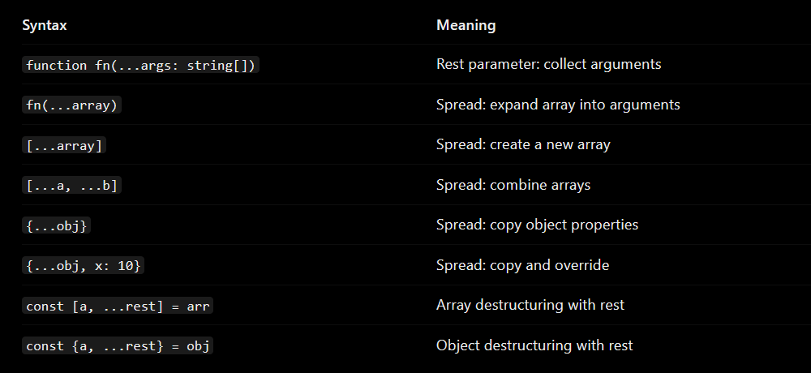
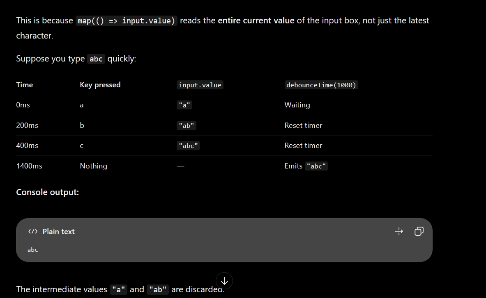
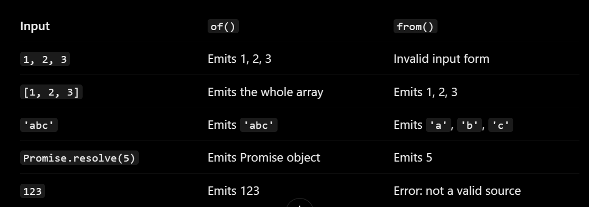
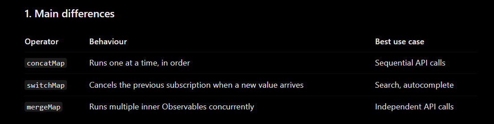

concatMap = Queue (one after another)

switchMap = Switch (latest wins)

mergeMap = Parallel (multiple at once)
Press Ctrl + Shift + V to open Markdown Preview.

Or press Ctrl + K, then V to open the preview side by side.
